# Data Model

```mermaid
erDiagram
    users ||--o{ account_users : "owns"
    users ||--o| email_alerts : "is alerted by"
    accounts ||--o{ account_users : "has"
    accounts ||--o{ transactions : contains
    categories |o--o{ transactions : categorizes
    categories ||--o{ category_splits : "defaults to"
    categories |o--o{ categories : "parent of"
    users ||--o{ category_splits : "weighted as"
    users ||--o{ global_split_weights : "weighted as"
    accounts ||--o{ account_split_weights : "defaults to"
    users ||--o{ account_split_weights : "weighted as"
    transactions ||--o{ transaction_splits : "split into"
    users ||--o{ transaction_splits : "owes"
    transactions ||--o{ transaction_tags : "tagged"
    tags ||--o{ transaction_tags : "on"
    transaction_links |o--o{ transactions : "links"

    transaction_history {
        int id PK
        int transaction_id "indexed, NOT a FK"
        string action "created | updated | deleted"
        string source "nullable; manual | csv_import | bank_sync | divide | admin | rule | categorizer | bulk"
        datetime changed_at "indexed"
        string batch_id "nullable, indexed; shared by the rows one action wrote"
        int changed_by_user_id "nullable, NOT a FK"
        date date "nullable snapshot"
        string payee "nullable snapshot"
        text memo "nullable snapshot"
        float amount "nullable snapshot"
        int account_id "nullable snapshot"
        int category_id "nullable snapshot"
        int accounting_month_offset "nullable snapshot"
        json changes "nullable; old/new per field, updated rows only"
    }

    users {
        int id PK
        string name "NOT NULL"
        string email "nullable"
        datetime created_at
    }

    account_users {
        int account_id PK,FK
        int user_id PK,FK
        float ownership_percentage "0-100, sum=100 per account"
    }

    accounts {
        int id PK
        string name
        string type
        float balance_offset "internal; displayed balance = this + sum(transactions)"
        string currency "ISO 4217 code, e.g. EUR, USD"
        datetime created_at
        boolean archived "default false; hides account from dashboard/new-tx picker, history unaffected"
    }

    categories {
        int id PK
        string name "UNIQUE"
        string type
        string color "nullable, e.g. #4f46e5"
        string icon "nullable, lucide-react icon name"
        int parent_id "nullable, FK -> categories.id; 2-level hierarchy only"
    }

    category_splits {
        int category_id PK,FK
        int user_id PK,FK
        int weight ">= 0, relative, no sum requirement"
    }

    global_split_weights {
        int user_id PK,FK
        int weight ">= 0, relative, no sum requirement"
    }

    account_split_weights {
        int account_id PK,FK
        int user_id PK,FK
        int weight ">= 0, relative, no sum requirement"
    }

    transactions {
        int id PK
        date date
        string payee
        text memo "nullable"
        float amount "negative=expense, positive=income"
        int account_id FK
        int category_id FK "nullable"
        int accounting_month_offset "months from date's month, -3..+3, default 0"
        boolean reconciled "manually set, default false"
        datetime created_at
        int divide_group_id "nullable, NOT a FK; anchor transaction's own id, shared by every part of a divide"
        int link_id FK "nullable, indexed, ON DELETE SET NULL; the group of linked transactions"
        float checkpoint_value "nullable; set on a checkpoint only, its amount is derived from it"
    }

    transaction_links {
        int id PK
        string name "nullable"
        datetime created_at
    }

    tags {
        int id PK
        string name "UNIQUE (case-insensitive in the API), no , ; |"
        string color "nullable, e.g. #4f46e5"
        datetime created_at
    }

    transaction_tags {
        int transaction_id PK,FK "ON DELETE CASCADE"
        int tag_id PK,FK "indexed, ON DELETE CASCADE"
    }

    transaction_splits {
        int transaction_id PK,FK
        int user_id PK,FK
        int weight "this transaction's own stored weight"
        float share_amount "derived from weight, recomputed on every write"
        string source "global | account | category | custom"
    }
```

## Tables

### `users`
Stores application users. Each user can own one or more accounts (via `account_users`).

| Column | Type | Notes |
|--------|------|-------|
| `id` | Integer | Primary key, autoincrement |
| `name` | String(100) | Required |
| `email` | String(200) | Optional |
| `created_at` | DateTime | Default: current UTC time |

### `account_users`
Junction table linking users to accounts with ownership percentages. Enables joint accounts.

| Column | Type | Notes |
|--------|------|-------|
| `account_id` | Integer | Foreign key → `accounts.id`, part of composite PK |
| `user_id` | Integer | Foreign key → `users.id`, part of composite PK |
| `ownership_percentage` | Float | Percentage of ownership (0–100). Sum must equal 100 per account |

### `accounts`
Financial accounts (checking, savings, credit card, etc.).

| Column | Type | Notes |
|--------|------|-------|
| `id` | Integer | Primary key, autoincrement |
| `name` | String(100) | Required |
| `type` | String(50) | Required. One of `Income`, `Expense`, `Transfer, other` (`schemas.CATEGORY_TYPES`, enforced by the API, not the DB; Alembic `0020` moved any older free-text value to `Transfer, other`, and a backup archive's unknown type is mapped the same way on restore). Charts count only `Income` and `Expense` |
| `balance_offset` | Float | Default: 0.0. **Internal** — never exposed by the API. The balance a client sees is `balance_offset + sum(that account's transaction amounts)`, so it tracks activity instead of staying frozen. When a user enters a balance (on create, or by editing the Balance field), the backend stores `entered balance − current transaction total` here, so the account shows exactly what they typed until its next transaction |
| `currency` | String(3) | ISO 4217 code, e.g. `EUR`, `USD`. Default: `EUR` |
| `created_at` | DateTime | Default: current UTC time |
| `archived` | Boolean | Default: `false`. Hides the account from the dashboard and the new-transaction account picker; doesn't affect existing transactions, balances, or charts |

### `categories`
Transaction categories (income, expense, transfer).

| Column | Type | Notes |
|--------|------|-------|
| `id` | Integer | Primary key, autoincrement |
| `name` | String(100) | Required, unique |
| `type` | String(50) | Required |
| `color` | String(7) | Optional, hex color (e.g. `#4f46e5`) shown as the category's badge color |
| `icon` | String(50) | Optional, `lucide-react` icon name shown as the category's badge icon |
| `parent_id` | Integer | Optional, self-referential foreign key → `categories.id`. A strict 2-level hierarchy: a category with `parent_id` set is a subcategory, and its parent must itself have no parent. A subcategory's `type` must match its parent's |

### `transactions`
Individual financial transactions.

| Column | Type | Notes |
|--------|------|-------|
| `id` | Integer | Primary key, autoincrement |
| `date` | Date | Required |
| `payee` | String(200) | Required |
| `memo` | Text | Optional |
| `amount` | Float | Negative = expense, positive = income. Denominated in the parent account's `currency` — a transaction has no currency of its own |
| `account_id` | Integer | Foreign key → `accounts.id` |
| `category_id` | Integer | Foreign key → `categories.id`, nullable — an uncategorized transaction is shown as "Uncategorized" |
| `accounting_month_offset` | Integer | Months relative to `date`'s month this transaction should be accounted in. Range -3..+3, default 0 (same month as `date`) |
| `reconciled` | Boolean | Default: `false`. Manually set by the user once they've reviewed/validated the transaction — never inferred. Always `false` on creation and on CSV import |
| `created_at` | DateTime | Default: current UTC time |
| `divide_group_id` | Integer | Nullable, indexed, **not** a foreign key (same reasoning as `transaction_history` below — a real FK would block deleting one part of a divide while siblings still reference it). Set by "Dividing a transaction" (see below) to the group's anchor transaction's own `id`, on every part including the anchor itself (`divide_group_id == id` for the anchor). `NULL` for a transaction that's never been divided |
| `checkpoint_value` | Float | Nullable (Alembic `0025`). Set on a **checkpoint** only: what the whole account was worth at the end of `date`, as typed. A checkpoint's `amount` is derived and stored — this value minus the account's balance just before it (`balance_offset` plus every earlier row, ordered by date, ordinary rows before checkpoints on the same day, then id) — so balances, charts, splits and exports read it like any amount. `checkpoints.recompute()` re-derives every checkpoint of an account, in order, after anything that can move an earlier row: create, update (amount, date, account, value), delete, bulk move/delete, divide, import commit, bank sync. A checkpoint whose amount moves that way gets a history row `source="checkpoint"` with `changes.amount`; its typed value never moves. `TransactionUpdate.amount` is refused (422) on a checkpoint unless unchanged, `checkpoint_value` is refused on an ordinary row and can't be cleared; a checkpoint can't be divided. `TransactionOut.checkpoint_since` (computed, not stored) is the previous checkpoint's date on the account, where the period its amount covers starts, null for the first. Excluded from the CSV import's and the bank sync's date+amount duplicate detection, so a real row is never mistaken for one. On an account with checkpoints, `PUT /api/accounts/{id}` refuses a changed `balance` (the first checkpoint would absorb the new offset). In the backup archive |
| `external_id` | String(120) | Nullable. The identifier the bank gave a transaction pulled in by [Bank sync](#bank_connections) — the ASPSP's own `entry_reference`/`transaction_id`, or a locally derived `fp:` fingerprint when the bank supplies neither. `NULL` for everything else (manual entry, CSV import, divide parts, migrated history). Covered by a unique index on `(account_id, external_id)`, which is what makes a re-sync of an overlapping window a no-op; NULLs are exempt from uniqueness in both SQLite and Postgres, so pre-existing rows are unaffected |
| `raw_source` | String(20) | Nullable. Which feed wrote the `raw_*` columns below: `enable_banking` for a row pulled in by [Bank sync](#bank_connections), `csv_import` for a row brought in by CSV import (which fills only `raw_label`, with the file's payee as it was read), `linxo_export` for migrated history backfilled from the Linxo GDPR export. `NULL` for everything else. It exists because the two feeds share these columns but not their vocabularies — `raw_transaction_code` is an ISO 20022 code from a bank and a Linxo transaction type from the export, and nothing tells them apart from the value alone |
| `raw_label` | Text | Nullable. The label the source reported, before any renaming. This is the point of the whole `raw_*` group: `payee` and `memo` are the user's to rewrite, so without a frozen copy the original wording is lost the first time a transaction is renamed |
| `raw_counterparty` | String(200) | Nullable. Whoever the source named on the other side — the bank's `creditor`/`debtor` name, or Linxo's extracted merchant. Unlike `payee`, which falls back to the remittance text and then to a placeholder, this is empty when the source named nobody |
| `raw_transaction_code` | String(60) | Nullable. The source's own classification of the transaction. Read it according to `raw_source`: an ISO 20022 domain/family/sub-family (or code/sub-code) from a bank, a Linxo transaction type (`PointOfSale`, `DirectDebit`, …) from the export |
| `raw_merchant_category_code` | String(10) | Nullable. The merchant category code (MCC), when the bank supplies one. Never filled from the Linxo export, whose own MCC column is empty throughout |
| `raw_merchant_location` | String(120) | Nullable. Where the merchant was, as the source reported it. Filled from the Linxo export's city/postcode/country; banks generally don't supply it |
| `raw_initiated_date` | Date | Nullable. When the purchase actually happened, when the source distinguishes it from the day the entry was booked — a card payment is routinely booked several days later |
| `raw_booking_date` | Date | Nullable. The day the bank booked the entry (Enable Banking's `booking_date`). Kept separately because a synced transaction's own `date` is the day it was made (`transaction_date`), which differs over a weekend. Empty on rows synced before Alembic `0015` |

None of the `raw_*` columns is editable through the ordinary transaction endpoints: they are absent from `TransactionCreate`/`TransactionUpdate` by design, and present only on `TransactionOut`. The single exception is admin mode's `PUT /api/transactions/{id}/raw`, which rewrites only the fields it is sent (null or blank clears one), leaves `external_id` alone, and records a `transaction_history` row with `source="admin"` whose `changes` name the raw fields that moved. They take part in no computation — no balance, no chart, no split — and exist solely so the source's original wording survives a rename, which is what makes categorisation and rename suggestions trainable on real history rather than on already-cleaned labels. They do round-trip through backup export/import, since a restore that dropped them would silently undo a backfill nothing else can redo.

### `category_splits`
The **middle-priority** weight tier: an optional default split-weight for a category — e.g. "Mortgage" prefills 1:1 unless the transaction's account has its own weights configured, which win. Purely a prefill source for new/edited transactions' own weights; never live-resolved.

| Column | Type | Notes |
|--------|------|-------|
| `category_id` | Integer | Foreign key → `categories.id`, part of composite PK |
| `user_id` | Integer | Foreign key → `users.id`, part of composite PK |
| `weight` | Integer | Relative integer weight, `>= 0`. No sum requirement — it's a ratio, not a percentage |

### `global_split_weights`
The **lowest-priority** weight tier: a relative integer weight per user (e.g. proportional to income), used to prefill a transaction's weights when neither its account nor its category has a weight configured. Unlike `category_splits`/`account_split_weights`, this tier is a **mandatory floor**: every user gets a `weight=1` row here automatically on creation, and it can never be saved empty or entirely zeroed out — see "Splits are mandatory" above.

| Column | Type | Notes |
|--------|------|-------|
| `user_id` | Integer | Primary key, foreign key → `users.id` |
| `weight` | Integer | Relative weight (not a percentage), `>= 0` — normalized against the sum of all weights when prefilling |

### `account_split_weights`
The **highest-priority** weight tier: a relative integer weight per user, scoped to one account — when configured, it beats both the category and global tiers. Entirely independent of `account_users.ownership_percentage` — ownership and split weight are two separate, coexisting concepts (ownership drives visibility and the "paid" side of balances; this table only feeds split-weight prefill).

| Column | Type | Notes |
|--------|------|-------|
| `account_id` | Integer | Foreign key → `accounts.id`, part of composite PK |
| `user_id` | Integer | Foreign key → `users.id`, part of composite PK |
| `weight` | Integer | Relative weight, `>= 0`. No sum requirement |

### `transaction_splits`
Every transaction stores its **own** integer `weight` per involved user — freely typed by the client, or bulk-filled from a tier via a quick-access button (account > category > global priority, prefill-only). `share_amount` is always *derived* from `weight` against the transaction's current `amount`, recomputed and persisted on every create/update — it is never itself client-editable, and it is never re-resolved from the tiers' *current* configuration once the transaction exists (only its own stored `weight` matters going forward).

| Column | Type | Notes |
|--------|------|-------|
| `transaction_id` | Integer | Foreign key → `transactions.id`, part of composite PK |
| `user_id` | Integer | Foreign key → `users.id`, part of composite PK |
| `weight` | Integer | This transaction's own stored weight for this user |
| `share_amount` | Float | What this user is liable for — derived from `weight`, recomputed on every write |
| `source` | String(20) | Which tier/button last produced this weight set: `global`, `account`, `category`, or `custom` (hand-typed) — display-only, never used for split logic |

### `transaction_history`
Audit trail: one row per transaction create/update/delete, with a snapshot of the transaction's fields at that moment. Deliberately **not** linked by foreign key to `transactions` or `users` — see Key Relationships below.

| Column | Type | Notes |
|--------|------|-------|
| `id` | Integer | Primary key, autoincrement |
| `transaction_id` | Integer | Indexed, but not a foreign key |
| `action` | String(20) | `created`, `updated`, or `deleted` |
| `source` | String(20) | Optional; `manual`, `csv_import`, `bank_sync` or `divide` on `created` rows, `divide` again on the `updated` row recorded when a transaction becomes a divide's anchor part; `rule` on an `updated` row an automatic rule wrote, `categorizer` on one the model wrote, `admin` on a raw-field edit, `bulk` on the rows a Bulk Edit or a bulk delete wrote (since Alembic `0023`; earlier bulk edits left it `NULL`, like an edit made in the transaction form) |
| `changed_at` | DateTime | Default: current UTC time. Indexed (Alembic `0023`) |
| `batch_id` | String(32) | Nullable, indexed (Alembic `0023`). One random id shared by every row one action wrote — a bulk edit or delete, applying rules or suggestions to a selection, an import commit, one bank account's sync (its created rows plus what the model and the rules then changed on them), a divide, deleting a tag — set by `audit.batch()`/`@audit.batched`. `NULL` on a row written alone and on every row written before `0023`, which is never rewritten |
| `changed_by_user_id` | Integer | Optional, not a foreign key |
| `date` / `payee` / `memo` / `amount` / `account_id` / `category_id` / `accounting_month_offset` | (matches `transactions`) | Nullable snapshot of the transaction's fields at the time of the change |
| `changes` | JSON | Optional; on `updated` rows, `{field: {"old": ..., "new": ...}}` for changed `transactions` columns; on `created` rows, only ever a `splits` key (below) — never the scalar transaction fields, since there's nothing to diff a brand-new row against |
| `changes.splits` | JSON (nested key) | Present only when the transaction's `transaction_splits` weights changed (`updated`) or were set on creation (`created`): `{"old": [...] \| null, "new": [...]}`, each list a snapshot of `{"user_id", "weight", "source"}` per involved user at that moment. `old` is `null` on a `created` row (no prior state); `[]` means "no splits" on either side. Never populated on `deleted` rows. |

### `aggregate_cache`
Generic store for precomputed aggregate results (dashboard/balances, charts), backing the caching service in `backend/cache_service.py` — not a domain entity, and not part of `backup`'s export/import (backup restore wipes/resets it instead, see Key Relationships below).

| Column | Type | Notes |
|--------|------|-------|
| `cache_key` | String | Primary key — `"<namespace>:k1=v1:k2=v2..."`, e.g. `balances:user_id=3` |
| `namespace` | String | Indexed; groups related entries for bulk invalidation, e.g. `balances`, `charts` |
| `payload` | Text | `json.dumps()` of the cached result |
| `computed_at` | DateTime | When this entry was (re)computed |

### `categorizer_models`
One trained category suggestion model (`backend/categorizer.py`) — derived data, not a domain entity, and not part of the account/transaction ER diagram above. The fitted model is a gzipped pickle in `blob`, stored in the database rather than on disk because the backend runs several Cloud Run instances and the one answering a suggestion is rarely the one that trained it. Several rows are kept (the five most recent) so a model that scores worse than its predecessor can be rolled back; at most one row is `is_active`, and that is the one suggestions use. Not part of `backup`'s export/import archive — a few megabytes of pickle that retraining rebuilds in seconds — but, like `onedrive_backup_settings`, left out of the overwrite restore's wipe, so restoring a backup doesn't throw away the active model.

| Column | Type | Notes |
|--------|------|-------|
| `id` | Integer | Primary key |
| `created_at` | DateTime | When the training run started |
| `status` | String(20) | `training` \| `ready` \| `failed`; a `training` row younger than 15 min is also the lock that stops two fits running at once |
| `is_active` | Boolean | At most one row true; the model `POST /api/categorizer/suggest` uses |
| `trained_rows` | Integer | Rows the fit actually learned from (a category plus a label to learn it from) |
| `tested_rows` | Integer | Rows of the test selection it was scored on |
| `note` | String(200) | Optional free-text label for the run |
| `params` | JSON | Feature counts and class count (models trained before automatic rules also carry the retired payee memory's `payee_min_occurrences`/`payee_min_stability`) |
| `metrics` | JSON | What it scored on the test selection: `accuracy`, `parent_accuracy`, `top3_accuracy`, a `thresholds` table, and the naive `baseline` it was compared against (older models also carry a `payee` block from the retired payee memory) |
| `error` | Text | Set when `status` is `failed` |
| `blob` | LargeBinary | Gzipped pickle of the fitted model, written and read only by `categorizer.py` |

### `transaction_rules`
The automatic rules (`backend/transaction_rules.py`, `routers/transaction_rules.py`): conditions to match a transaction and actions to apply to it, run on every bank sync, offered on the import preview, and run on a selection by hand. Not part of the account/transaction ER diagram above: nothing references a rule, and a rule references accounts and categories only by id inside its JSON, so deleting a category a rule names is not blocked — the rule's action on it is simply skipped from then on. Part of the backup archive (`transaction_rules`), restored in overwrite mode only, since a partial restore renumbers the very ids rules name.

| Column | Type | Notes |
|--------|------|-------|
| `id` | Integer | Primary key |
| `name` | String(100) | Shown on the Rules screen and in previews |
| `position` | Integer | Run order, ascending. Every matching rule applies in turn, each reading the row as the earlier ones left it, so a later rule wins on a field both set |
| `enabled` | Boolean | Disabled rules never run on their own; they can still be picked when applying rules to a selection |
| `match_mode` | String(3) | `all` \| `any`, how `conditions` combine |
| `conditions` | JSON | List of the advanced filter's own `FilterCondition` objects (`field`, `operator`, `value`, `value2`). The filter's per-user fields (`split_weight`/`split_share`/`split_balance`, plus the unsigned `split_share_abs`/`split_balance_abs`, with a `user_id`) are refused here, since an import preview row has no split yet, and so is `created_at` (a row being imported has not been added). The other fields: `payee`, `memo`, the `raw_*` text and date columns, `amount`, `amount_abs` (the amount without its sign), `date`, `account_id`, `category_id` (also `in`/`not_in` a list of ids, a null in a category list meaning uncategorized; `not_in` never matches a row with no value), `accounting_month_offset`, `tag_id`, and `reconciled` (`eq` with a boolean). Evaluated in Python by `transaction_rules._matches()`, which mirrors `filtering.build_condition_expr()` operator for operator, NULLs included, because the import preview runs rules on rows that exist only in a file |
| `actions` | JSON | `RuleActions`: any of `payee`, `category_id`, `accounting_month_offset`, `reconciled`, `split_weights` (+ `split_source`), or instead `split_tier` (`global`/`account`/`category`/`default`), a weight tier read when the rule runs rather than weights copied into it, skipped when that tier is unset for the row. Never an account move or a delete |
| `created_at` / `updated_at` | DateTime | |

A rule leaves `reconciled` as it is unless one of its actions sets it (an earlier version unreconciled every row it changed, which sent already-reviewed rows back to review on a mere rename), and a row it changes gets a `transaction_history` row with `source="rule"`. On a bank sync, a rule that sets a category without its own split re-resolves the new row's split through the usual cascade (`fresh=True`), since that row's split was resolved before any category was known; an existing row keeps its split, as with Bulk Edit.

### `saved_filters`
The Transactions screen's saved filters (`routers/saved_filters.py`): a filter saved under a name and shown as a button next to Simple/Advanced. One list for the whole household (not per user), so a filter saved on one device shows on every other. Nothing references a saved filter, and it names accounts and categories only by id inside its JSON, so deleting one of those is never blocked — the filter then simply matches nothing on that field. Part of the backup archive (`saved_filters`), restored in overwrite mode only, for the same reason as `transaction_rules`.

| Column | Type | Notes |
|--------|------|-------|
| `id` | Integer | Primary key |
| `name` | String(100) | The button's label |
| `position` | Integer | Button order, ascending; changed by drag and drop (`PUT /api/saved-filters/order`) |
| `mode` | String(10) | `simple` \| `advanced`, the filter it was saved from |
| `filters` | JSON | That filter exactly as the screen holds it, stored and returned as is, never read by the backend: `simple` → `search`, `date_from`, `date_to`, `account_id`, `category_id`, `amount_min`, `amount_max`, `reconciled`; `advanced` → `match_mode` and the condition rows (`field`, `operator`, `value`, `value2`). Both also carry `sort_dir` (`asc` \| `desc`), the date order saved with the filter |
| `created_at` / `updated_at` | DateTime | |

### `tags` and `transaction_tags`
Free labels on transactions (`backend/tags.py`, `routers/tags.py`, Alembic `0022`), many-to-many: `transaction_tags` holds one row per (transaction, tag), written through `Transaction.tags`. A tag feeds no balance, chart, split or cache namespace; it is searched (simple filter `tag_id`/`untagged`, advanced condition `tag_id` with `eq`/`ne`, a null value meaning "no tag at all", like an uncategorized `category_id`), set by hand (`tag_ids` on create/update, replacing the whole set), in bulk (`add_tag_ids`/`remove_tag_ids` on bulk-update, each row keeping its others), and by rules (`RuleActions.add_tag_ids`, add only). Every change to a transaction's tags writes a `changes.tags` entry (`{"old": [names], "new": [names]}`, names as they were then) in `transaction_history`, including the removals done by deleting a tag (`DELETE /api/tags/{id}`). Divide parts inherit the original's tags. In the backup archive (`tags`, `transaction_tags`), restored by both modes: a partial restore reuses an existing tag of the same name; `None` is an archive from before tags. Exported in the Transactions CSV/Excel as one `Tags` column, names separated by `, `, which is why a name can't contain `,`, `;` or `|`.

### `transaction_links`
Groups of linked transactions (`backend/transaction_links.py`, `routers/transaction_links.py`, Alembic `0024`): a transfer's two sides, an expense and its refunds, a shared expense and what the others paid back. Each member points at its group through `transactions.link_id` (a real FK, `ON DELETE SET NULL`), so a transaction belongs to one group at most. Nothing is split or created, and a group feeds no balance, chart, split or cache namespace: it exists so the detail panel can list the members and their net (`GET /api/transaction-links/{id}`, `totals` summed per currency). `POST /api/transaction-links` links two or more transactions; any of them already in a group brings that group along, the groups merging into the oldest (its name kept unless a new one is given), which is how a row joins an existing group. `PUT` renames (blank clears), `POST /{id}/unlink` takes members out and `DELETE /{id}` dissolves it. A group always has at least two members: one left with fewer, by an unlink or a transaction delete (single or bulk, `transaction_links.prune()`), is deleted and its last member unlinked. Every join or leave writes a `changes.link` entry (`{"old": label, "new": label}`, the label being the group's name, else `#id`) under `source="link"` in `transaction_history`. Searched by the advanced condition `linked` (`eq` true/false, refused by rules). In the backup archive (`transaction_links`, plus each transaction's `link_id`), restored by both modes: a partial restore recreates a group under a new id when at least two of its members are restored; `None` is an archive from before links.

### `email_alerts`
Each user's email alert on new transactions (`backend/email_alerts.py`, `routers/email_alerts.py`, Alembic `0021`): at most one row per user, created the first time their settings are saved on the Email alerts screen. A transaction is "new" by its `created_at` (when it reached MyFinance: bank sync, import or typed in), not its `date`, and only on accounts the user owns (`ownership_percentage > 0`). Sent at the end of the bank sync, never on a schedule of their own: the scheduled `POST /api/bank-sync/run-due` (0h/6h/12h/18h Paris) sends whatever is due — daily with the 6h sync, weekly with the Sunday 18h sync, monthly with the 18h sync of the month's last day, a missed one with the next sync — and a sync started by hand also sends the daily alert of whoever has something new. An email lists at most 100 rows, most recent first, and counts the rest; a window with nothing new sends nothing. Sent over SMTP (`SMTP_HOST`/`SMTP_PORT`/`SMTP_USERNAME`/`SMTP_PASSWORD`) from `ALERT_FROM_ADDRESS`. Deleting a user deletes their row. Part of the backup archive (`email_alerts`), restored in overwrite mode only; `None` is an archive from before alerts.

| Column | Type | Notes |
|--------|------|-------|
| `user_id` | Integer | Primary key, FK → `users.id` |
| `email` | String(200) | Nullable; where the alerts go. Defaults on screen to the user's own `email`. Required as soon as one frequency is on |
| `daily` / `weekly` / `monthly` | Boolean | Default: `false`; any combination |
| `last_daily_sent_at` / `last_weekly_sent_at` / `last_monthly_sent_at` | DateTime | Nullable, naive UTC: the end of the window the last alert of that frequency covered, and the start of the next. Set to the moment a frequency is switched on, so its first email holds only what arrives from then on. Moves on a successful send (or an empty window), never on a failed one, so a failure is retried by the next sync |
| `last_status` | String(20) | Nullable; `success` or `failed`, of the last run that had something due |
| `last_error` | Text | Nullable; set when `last_status` is `failed`, naming the frequency |

### `onedrive_backup_settings`
Single global row (`id=1`) driving the OneDrive automatic backup connection (`backend/onedrive.py`) — one connection for the whole household database, not per-user, and not part of the account/transaction ER diagram above. Not part of `backup`'s export/import archive either: it's app configuration, not domain data, and its refresh token opens the very drive those archives are uploaded to. An overwrite restore leaves this table alone (it's left out of the restore's wipe), so restoring never disconnects OneDrive. Token columns are Fernet-encrypted at rest and never returned by the API.

| Column | Type | Notes |
|--------|------|-------|
| `id` | Integer | Primary key; always `1` |
| `connected` | Boolean | Default: `false` |
| `account_email` | String | Nullable; the connected Microsoft account's email, for display only |
| `folder_path` | String | Nullable; the OneDrive folder backups are uploaded to, created automatically if missing |
| `keep_daily` / `keep_weekly` / `keep_monthly` / `keep_yearly` | Integer | Defaults: 8 / 5 / 13 / 10 (Alembic `0017`). Grandfather-father-son retention: after each successful run, the newest backup of each of the last N days / ISO weeks / months / years is kept (a file can count for several tiers), plus always the newest backup; every other `myfinance-backup-YYYYMMDD-HHMMSS.zip` in the folder is deleted. 0 turns a tier off; at least one must be above 0. Other files in the folder are never touched |
| `access_token_encrypted` / `refresh_token_encrypted` | Text | Nullable; Fernet-encrypted OAuth tokens, keyed by `ONEDRIVE_TOKEN_ENCRYPTION_KEY` |
| `token_expires_at` | DateTime | Nullable; when the access token expires, so it's refreshed just-in-time |
| `last_backup_at` | DateTime | Nullable; also doubles as the "claim" timestamp written before a run starts, so an overlapping scheduler call sees it as no longer due |
| `last_backup_status` | String(20) | Nullable; `success` or `failed` |
| `last_backup_error` | Text | Nullable; set only when `last_backup_status` is `failed` |

### `bank_connections`
One consent granted with one bank (ASPSP) through Enable Banking (`backend/enable_banking.py`). Unlike `onedrive_backup_settings` there can be several rows — a consent is granted per bank. Not part of the account/transaction ER diagram above. Part of `backup`'s export/import archive (`bank_connections`, alongside `bank_account_links`), so an overwrite restore brings each consent back instead of forcing a new authorization at every bank; append mode ignores both sections, and an archive written before they existed restores with no bank connected. No bank-issued token is stored — Enable Banking authenticates MyFinance with a JWT signed per request from `ENABLE_BANKING_PRIVATE_KEY`, so `session_id` is only an identifier.

| Column | Type | Notes |
|--------|------|-------|
| `id` | Integer | Primary key, autoincrement |
| `aspsp_name` | String(100) | The bank's name as Enable Banking's catalogue spells it |
| `aspsp_country` | String(2) | ISO 3166 country code. Default: `FR` |
| `state` | String(64) | Indexed. Random nonce round-tripped through the bank's consent screen, so the callback can match the redirect back to its pending connection |
| `authorization_id` | String(64) | Nullable; Enable Banking's id for the authorization in flight |
| `session_id` | String(64) | Nullable; set once consent is granted, and what account calls are made against. Never serialized by the API |
| `status` | String(20) | `pending` (created, awaiting the user's return), `linked`, `expired`, or `error`. A `pending` row isn't listed by the API |
| `access_valid_until` | DateTime | Nullable; when the bank's consent lapses — 90 days for most French banks. Renewing it is a fresh authorization, not a token refresh |
| `created_at` | DateTime | Default: current UTC time |
| `last_error` | Text | Nullable; why the last connection attempt failed |

### `bank_account_links`
One account a `bank_connections` consent exposes, and the MyFinance account it feeds. Deliberately not columns on `accounts`: a remote account is listed before anyone decides where it goes, and re-consenting to the same bank yields new remote uids for the same real accounts (matched back by IBAN, which is what preserves the mapping across a renewal).

| Column | Type | Notes |
|--------|------|-------|
| `id` | Integer | Primary key, autoincrement |
| `connection_id` | Integer | Foreign key → `bank_connections.id`, indexed |
| `remote_account_uid` | String(64) | Enable Banking's id for this account; changes on every re-consent |
| `iban` | String(50) | Nullable; also the key used to re-point an existing link after a re-consent |
| `remote_name` / `currency` | String | Nullable; as reported by the bank, for display |
| `account_id` | Integer | Foreign key → `accounts.id`, nullable, indexed. `NULL` until the user maps it; nothing is imported while it is. Enforced unique across links at the app level (`rules.validate_bank_link_account`), and an archived account can't be picked |
| `sync_enabled` | Boolean | Default: `true` |
| `sync_from_date` | Date | Nullable. The first sync never reaches back past this; defaults to the day the link is mapped, so connecting a bank doesn't re-import history that already arrived via CSV/migration |
| `last_synced_at` | DateTime | Nullable; also the "claim" timestamp written before a run starts, so an overlapping scheduler call sees it as no longer due — and written on failure too, since banks cap account calls at 4 a day |
| `last_sync_status` | String(20) | Nullable; `success` or `failed` |
| `last_sync_error` | Text | Nullable; set only when `last_sync_status` is `failed` |
| `last_imported_count` | Integer | Default: 0. How many transactions the last successful run created |

## Key Relationships

- **Users ↔ Accounts**: Many-to-many via `account_users`. Each user can own multiple accounts; each account can have multiple owners (joint account).
- **Accounts ↔ Transactions**: One-to-many. An account can have many transactions.
- **Categories ↔ Transactions**: One-to-many, and optional — `category_id` is nullable, so a transaction can have no category ("Uncategorized"). A transaction may be assigned either a top-level category or a subcategory — there's no requirement to always pick the most specific one.
- **Categories ↔ Categories (subcategories)**: Self-referential, one-to-many via `parent_id`, capped at exactly 2 levels — a category with `parent_id` set (a subcategory) cannot itself have children, enforced in `backend/main.py` rather than at the DB level. A subcategory's `type` must equal its parent's. Deleting a category with existing subcategories is blocked (409), the same pattern used for a category with existing transactions. Subcategories do **not** inherit their parent's `category_splits` weight tier — each category's split-weight prefill is independent of the hierarchy. Chart grouping is a partial exception: `charts.py`'s month-by-category aggregation (backing the Charts page's "Spending per month" chart) rolls a subcategory's spend up into its parent for the top-level/overview view, and supports drilling into a parent's direct subcategories (plus a segment for transactions categorized directly on the parent itself, since both remain independently assignable) — the flat, ungrouped `by_category` aggregation used elsewhere still has no rollup.
- **Ownership validation**: The backend enforces that ownership percentages sum to exactly 100% per account (within 0.01 tolerance).
- **User filtering**: API endpoints `/api/transactions`, `/api/dashboard`, `/api/accounts` accept an optional `?user_id=X` query parameter to filter by account ownership (where `ownership_percentage > 0`).
- **Accounting month**: each transaction stores `accounting_month_offset` (months relative to its own `date`, -3..+3, default 0), letting a transaction be attributed to a different reporting month than the one it was dated in — e.g. a paycheck dated the last day of a month that should count toward the next. The API also returns a derived, not stored, `accounting_month` ("YYYY-MM") computed from `date + accounting_month_offset` (`backend/accounting_month.py`), for reports/dashboards to group by later.
- **Splits are mandatory, but prefill is never live-resolved** (`backend/split_engine.py`): every transaction always stores its own integer `weight` per involved user in `transaction_splits` — freely editable, or bulk-filled via a quick-access button from one of three tiers, in ascending priority: `global_split_weights` (lowest) → `category_splits` (middle) → `account_split_weights` (highest, wins when configured). If the client omits `split_weights` on create/update, the server resolves one itself via this same cascade (`resolve_default_weights()`), which is what makes the mandate possible: `global_split_weights` is a guaranteed non-empty floor (every user gets `weight=1` there by default the moment they're created — see below), so the cascade can never come back empty in normal use. An explicit empty `split_weights` list is rejected (422) rather than clearing a transaction's split, and an update that omits it but finds the transaction already has zero split rows (a pre-mandate data artefact) heals it via the same cascade rather than leaving it that way. `resolve_default_weights()` is never consulted again once a transaction exists otherwise, so changing a tier's weights later never retroactively changes an existing transaction's split. Deleting a user who's the sole participant in a transaction's split re-resolves it the same way (`routers/users.py::delete_user`), or 409s if the cascade comes up empty too. There is no single-owner-account gating of any kind — a tier's weights apply regardless of how many owners an account has.
- **The global tier is a mandatory floor, unlike account/category**: `POST /api/users` inserts a `GlobalSplitWeight(weight=1)` row for every new user, and `PUT /api/split-weights` rejects a save that would leave it empty or entirely zeroed out (`rules.validate_global_weights_present`) — the account and category tiers have no such floor and may legitimately be left unconfigured, since they're allowed to cascade down to global.
- **Ownership and split weight are independent, coexisting concepts**: `account_users.ownership_percentage` is unrelated to `account_split_weights` — the former drives account/dashboard visibility filtering, the sum-to-100 ownership validation, and the "paid" side of balance math (below); the latter is purely one of the three split-weight prefill tiers. A single-owner account can have a configured `account_split_weights` row just like a joint one.
- **Splits are frozen, ownership is live**: `transaction_splits.share_amount` (what a user is *liable* for) is recomputed from the transaction's own stored `weight` and persisted on every write that touches either the weight or the amount — but never re-derived from the *tiers'* current configuration. What a user *paid* is instead derived live from the account's *current* `account_users.ownership_percentage` — so historical liability stays stable even if account ownership changes later, but the settlement report always reflects today's ownership. The household balance report (`GET /api/balances`, also embedded in `GET /api/dashboard`) is `sum(paid) − sum(share_amount)` per user — positive means the household owes them, negative means they owe the household.
- **Multi-currency accounts, no conversion**: each account has its own `currency`; transactions and splits inherit it from their account rather than storing it themselves. Amounts are never converted or summed across currencies — `compute_balances()` (`backend/split_engine.py`) partitions by `(user_id, currency)`, so `GET /api/balances` returns one net position per user *per currency*, and a household with mixed-currency accounts gets a separate settlement line for each currency instead of a single blended total.
- **Aggregate caching**: `GET /api/dashboard`, `GET /api/balances`, and `GET /api/charts` cache their computed results in `aggregate_cache` (`backend/cache_service.py`), keyed by namespace (`balances`, `charts`, `account_totals`) plus request params (e.g. `user_id`, `currency`, and for `charts`, also `start_month`/`end_month`/`parent_category_id`), rather than recomputing `compute_balances()`/`compute_chart_data()`'s Python-side aggregation on every request. Every mutation that can change these sums — transaction create/update/delete/bulk/divide, CSV import commit, an account's currency/ownership change, a category's type change, deleting a user (which can re-resolve other users' splits) — invalidates the relevant namespace before its own commit; a bulk backup restore, which bypasses all of those, resets the whole cache instead. DB-backed (not in-process) because the backend can run multiple Cloud Run instances.
- **Dividing a transaction** (`POST /api/transactions/{id}/divide`) is unrelated to `transaction_splits`/`split_weights` above — that divides one transaction's amount among *users*, while this divides one transaction into *several new transactions*, by category/date/amount, each keeping its own independently-resolved `transaction_splits`. The original transaction becomes the group's anchor: it's updated in place to become the first part (keeping its `id` and `transaction_history` trail), and the remaining parts are new `transactions` rows on the same `account_id`, each user-split resolved via the usual `resolve_default_weights()` cascade unless the request specifies its own. Every part, anchor included, gets `divide_group_id` set to the anchor's `id`. A part amounts must sum exactly to the original transaction's amount (`rules.validate_divide_parts`); a transaction that's already a non-anchor part of a group (`divide_group_id` set to some other transaction's `id`) can't be divided again directly — only its group's anchor can, which simply adds more parts to the same group rather than starting a new one.
- **OneDrive backup is a singleton config row, not domain data**: `onedrive_backup_settings` always has exactly one row (`id=1`), fetched/created via `onedrive.get_or_create_settings()`. It's unrelated to any account, user, or transaction — a household has one OneDrive connection for the whole database, not one per user — and is excluded from `backup`'s export/import archive entirely (restoring a backup never touches the connection — the overwrite restore's wipe skips this table). GCP Cloud Scheduler is expected to call `POST /api/onedrive/backup/run-due` periodically (protected by a shared-secret header, `ONEDRIVE_SCHEDULER_SECRET`); the endpoint itself decides whether a backup is actually due based on `last_backup_at` (one backup a day), so the scheduler's own polling interval only needs to be at least daily.
- **Automatic categorisation reads the raw label, not the payee**: `categorizer.py` trains on `transactions.raw_label` (falling back to `payee` only when a row predates the raw columns), because a newly synced transaction carries what the bank said rather than what anyone renamed it to — the two differ on 57.7% of the migrated history, so a model trained on cleaned labels and run on raw ones would report a precision it could not deliver. Suggestions are written back one row at a time through `POST /api/categorizer/apply`, which is deliberately *not* `PUT /api/transactions/bulk-update`: that endpoint applies the same value to every row it touches. Every row the categorizer writes is left `reconciled = false`, whatever it was before — an applied-but-uncertain suggestion has to stay findable, and an empty category hides where an unreconciled row shows. A category already set by hand is skipped unless the request passes `overwrite_category`. History rows for these writes are tagged `source="categorizer"`.
- **The History screen groups history rows, it stores nothing**: `GET /api/history` (`backend/history.py`) reads `transaction_history` newest first (by `id`) and merges consecutive rows into one entry when they share a `batch_id`, `action` and `source`, or — for rows without a `batch_id`, written before batches existed — the same `action`, `source`, author and change (same fields set to the same values; payee/memo/date/amount count by name only, since a prepend or a regex gives every row its own) within 60 s of each other. That second rule is a guess: two identical bulk edits run back to back read as one. Pagination is by cursor (`before_id`), and a page always ends on a complete entry. An entry is addressed by its id range plus what its rows share (`HistoryGroupRef`, `history.group_filter()`), which is what `GET /api/history/rows` lists and what `TransactionSearchRequest.history_group` filters the Transactions screen on.
- **Audit trail is intentionally unlinked**: `transaction_history.transaction_id` and `changed_by_user_id` are plain (indexed) integers, not foreign keys. SQLite runs with `PRAGMA foreign_keys=ON`, so a real FK to `transactions.id` would either block a hard delete or be cascaded away with it — defeating the point of an audit log that must outlive the row it describes. History rows are written by `backend/audit.py` on every transaction create/update/delete and read via `GET /api/transactions/{id}/history`. Split-weight changes are part of this trail too: `changes.splits` captures a transaction's `transaction_splits` state whenever it's set on creation or changed on an update (see `transaction_history` above) — deletion doesn't snapshot splits separately, since the cascade-deleted `transaction_splits` rows are implied by the transaction's own `deleted` row.
